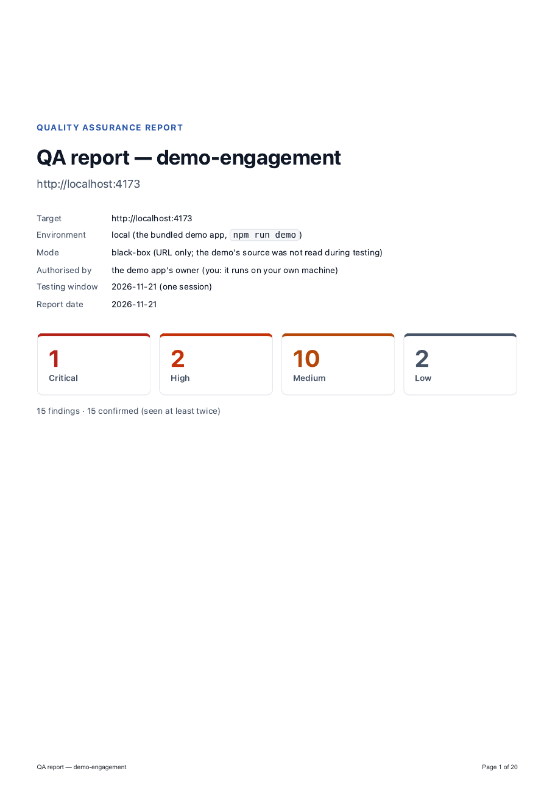
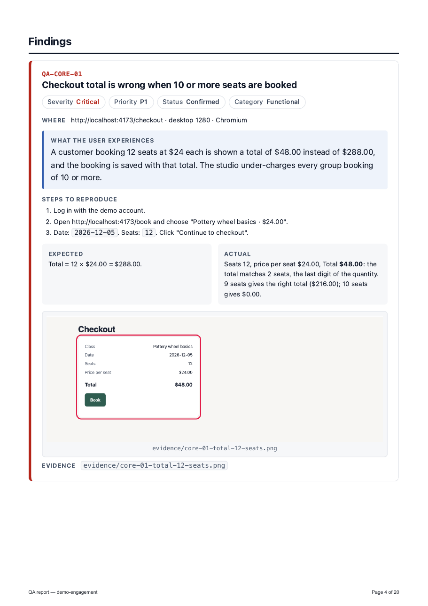

# open-qa-harness

**End-to-end QA for any web app.** Give it a URL, or a URL and the code. It maps every page, tests
them the way a real user would, verifies every bug, and hands you a PDF report a developer can fix from.

[](https://github.com/Shresth0710/open-qa-harness/actions/workflows/ci.yml)
[](LICENSE)
[](https://github.com/Shresth0710/open-qa-harness/releases)

**In Claude Code**, install the plugin, then QA a site:

```text
/plugin marketplace add Shresth0710/open-qa-harness
/plugin install oqa@open-qa-harness
/oqa:qa https://your-app.example.com
```

**See it work in about a minute**, without AI, on a bundled demo app with planted bugs:

```bash
git clone https://github.com/Shresth0710/open-qa-harness && cd open-qa-harness
npm install && npx playwright install chromium
npm run try
```

→ **[Sample report (PDF)](examples/demo-engagement/report/report.pdf)**: 15 findings, each with plain-words impact,
exact steps and the screenshot that shows the bug.

<p align="center">
  
  
</p>

---

## What it does

| Step | What happens | Tool |
|---|---|---|
| **1 · Scope** | Authorisation, goal, reader, environment, accounts, and the **rules of engagement** (what you may create, send or pay) | `oqa init` → `engagement.md` |
| **2 · Recon** | Crawl + sitemap + JS-bundle routes, with console errors, failed requests and desktop/mobile screenshots per page | `oqa recon` |
| **3 · Automated pass** | Accessibility (axe-core, WCAG 2.2 AA tags), security headers, cookie flags, broken links, console errors, lab LCP/CLS, mobile overflow, passwords sent by GET; in Chromium, Firefox or WebKit | `oqa scan` |
| **4 · Hands-on testing** | Area by area (4–6 routes each): happy path, boundaries, state, roles, mobile, side effects | the [method](method/) + checklists; or agents |
| **5 · Findings** | One format for every bug: severity, priority, status, plain-words impact, steps, expected/actual, evidence | `oqa new-finding`, `oqa lint` |
| **6 · Verification** | A different person or agent re-runs every Critical/High from the write-up alone | [`method/09`](method/09-verification.md) |
| **7 · Report** | Self-contained HTML + PDF: summary, coverage, findings sorted by severity; CSV or GitHub-issue export for your tracker | `oqa report --pdf`, `oqa export` |
| **8 · Regression** | One failing-first Playwright test per confirmed High/Critical bug | `/oqa:qa-regress` |

## Two modes

**Black-box: you only have a URL** (and maybe a login). This is the common case, and it finds most
of what users hit. Recon builds the page list from crawling, the sitemap and the JS bundle. Testing
is exploratory, guided by charters and checklists. → [`method/04`](method/04-black-box-execution.md)

**White-box: you also have the code.** An agent reads the repo (read-only) for the real routes,
endpoints, validation rules and role checks, and writes them as testable requirements. Each one is
then checked **twice**, through the API and through the browser. Where the two disagree, you
usually have the most valuable bug in the report. → [`method/05`](method/05-white-box-with-a-repo.md)

## Three ways to use it

### 1. Claude Code plugin (fully guided)
```text
/plugin marketplace add Shresth0710/open-qa-harness
/plugin install oqa@open-qa-harness
```
| Command | Does |
|---|---|
| `/oqa:qa <url> [notes]` | the whole engagement: scope → recon → scan → test each area → verify → report |
| `/oqa:qa-scope <url>` | asks the scoping questions and writes `engagement.md` |
| `/oqa:qa-recon <name>` | maps routes and splits them into areas |
| `/oqa:qa-explore <name> <AREA>` | hands-on testing of one area |
| `/oqa:qa-code <name> <repo-path>` | white-box: requirements from the code |
| `/oqa:qa-verify <name>` | independent re-run of a sample of findings |
| `/oqa:qa-report <name>` | builds the PDF and checks it like a reader |
| `/oqa:qa-regress <name>` | failing-first regression tests for confirmed bugs |

It ships four agents: **qa-explorer** (one per area), **qa-code-reader**, **qa-verifier** (never the
agent that found the bug) and **qa-reporter**. There's also an **open-qa** skill that loads the method
when you ask Claude to "QA this site".

The first `/oqa:qa` runs `oqa doctor`. A fresh plugin install has no Node packages or browser yet.
Doctor prints the two exact commands (`npm install --prefix <plugin folder>` and
`npx playwright install chromium`), and Claude runs them once.

> Cloned the repo instead? Open it in Claude Code and the same commands work without the prefix
> (`/qa`, `/qa-recon`, …).

### 2. Any other AI agent (Codex, Cursor, Gemini CLI, …)
Point it at [`AGENTS.md`](AGENTS.md). The method is plain markdown and the tools are a plain CLI. The
agent prompts in [`agents/`](agents/) work as role descriptions in any tool.
The [`open-qa` skill](skills/open-qa/SKILL.md) also works when installed on its own from a skills directory:
it tells the agent where to get the method and the `oqa` tool if they are missing.

### 3. No AI at all
The method is written for people first. Use the CLI and the checklists:
```bash
node bin/oqa.mjs doctor
node bin/oqa.mjs init shop --url https://staging.example.com
node bin/oqa.mjs login https://staging.example.com --save auth/owner.json   # you sign in by hand
node bin/oqa.mjs recon https://staging.example.com --out engagements/shop --auth auth/owner.json
node bin/oqa.mjs scan --from engagements/shop/recon.json --out engagements/shop --auth auth/owner.json
node bin/oqa.mjs new-finding engagements/shop AUTH      # write findings as you test
node bin/oqa.mjs lint engagements/shop
node bin/oqa.mjs report engagements/shop --pdf
node bin/oqa.mjs export engagements/shop --format csv     # or --format github: issue bodies + a script you run with GH_REPO=owner/repo
```

## The method

Fourteen short chapters, with sources for the external facts (ISTQB, WCAG 2.2, OWASP, Core Web Vitals):

[00 Principles](method/00-principles.md) ·
[01 Scoping & rules](method/01-scoping-and-rules.md) ·
[02 Recon](method/02-recon.md) ·
[03 Test design](method/03-test-design.md) ·
[04 Black-box](method/04-black-box-execution.md) ·
[05 White-box](method/05-white-box-with-a-repo.md) ·
[06 Evidence](method/06-evidence.md) ·
[07 Severity & priority](method/07-severity-and-priority.md) ·
[08 Bug reports](method/08-writing-bug-reports.md) ·
[09 Verification](method/09-verification.md) ·
[10 Reporting](method/10-reporting.md) ·
[11 Regression & CI](method/11-regression-and-ci.md) ·
[12 Safety in production](method/12-safety-in-production.md) ·
[13 QA with AI agents](method/13-qa-with-ai-agents.md)

Ten checklists: [accessibility](method/checklists/accessibility.md) · [auth & sessions](method/checklists/auth-and-sessions.md) ·
[forms](method/checklists/forms-and-input.md) · [mobile](method/checklists/mobile-and-responsive.md) ·
[performance](method/checklists/performance.md) · [security (passive)](method/checklists/security-passive.md) ·
[payments](method/checklists/payments-and-billing.md) · [compatibility & browsers](method/checklists/compatibility-and-browsers.md) ·
[i18n](method/checklists/i18n-and-localisation.md) · [content & SEO basics](method/checklists/content-and-seo-basics.md)

### The rules it is built on
1. **Test as the user, report for the fixer.** Every finding has a plain-words line *and* exact steps.
2. **Nothing counts until you have seen it twice.** Seen once means `Unconfirmed`, and it stays labelled that way.
3. **Your test is a suspect too.** Change one variable and re-run before you file.
4. **Evidence or it did not happen.** The first screenshot shows the bug.
5. **Coverage is stated, never implied.** Every route gets a status.
6. **Do no harm.** `QA-TEST` prefix, sends only to your own addresses, never pay, existing records read-only.
7. **When two sources disagree, the disagreement is the finding.**
8. **Prefer checks that run to notes that are read.**

## A finding looks like this

A real one, from the [example engagement](examples/demo-engagement/) on the demo app:


```markdown
### QA-CORE-01 — Checkout total is wrong when 10 or more seats are booked
- **Severity:** Critical
- **Priority:** P1
- **Status:** Confirmed
- **Category:** Functional
- **Where:** http://localhost:4173/checkout · desktop 1280 · Chromium
- **What the user experiences:** A customer booking 12 seats at $24 each is shown a total of $48.00 instead of $288.00, and the booking is saved with that total. The studio under-charges every group booking of 10 or more.
- **Steps to reproduce:**
  1. Log in with the demo account.
  2. Open http://localhost:4173/book and choose "Pottery wheel basics · $24.00".
  3. Date: `2026-12-05`. Seats: `12`. Click "Continue to checkout".
- **Expected:** Total = 12 × $24.00 = $288.00.
- **Actual:** Seats 12, price per seat $24.00, Total **$48.00**: the total matches 2 seats, the last digit of the quantity. 9 seats gives the right total ($216.00); 10 seats gives $0.00.
- **Evidence:** `evidence/core-01-total-12-seats.png`
```

`oqa lint` checks every field, that IDs are unique and that each evidence file exists. `oqa report`
renders it. Full guide: [`method/08`](method/08-writing-bug-reports.md).

## Repository layout

```
method/              the method: 14 chapters + checklists
templates/           what `oqa init` copies into engagements/<name>/
bin/oqa.mjs, lib/    the CLI
commands/ agents/ skills/   Claude Code plugin (also linked under .claude/ for clones)
demo/                a small app with planted bugs; answers in demo/ANSWER-KEY.md
examples/            a complete engagement on the demo, including the PDF report
test/                node --test suite (lint must catch planted bad findings)
```

## Safety

Only test systems you own or are authorised to test. `oqa scan` is **passive**: it reads pages, headers and
cookies like a browser and requests each same-origin link once. It does not attack, fuzz or load-test.
Sessions saved by `oqa login` (`auth/*.json`) are live credentials. They are git-ignored; delete them when
you are done. See [SECURITY.md](SECURITY.md) and [method/12](method/12-safety-in-production.md).

## Requirements
Node.js 20+ · Chromium via Playwright (Firefox/WebKit optional, for cross-browser runs) (`npx playwright install chromium`) · `pdftotext`/`pdftoppm` (poppler) optional, for checking PDFs.

## Contributing
New checklists, demo bugs and `oqa scan` rules are welcome. Every new check ships with a planted bad case that must fail.
See [CONTRIBUTING.md](CONTRIBUTING.md).

## Licence
[MIT](LICENSE)
